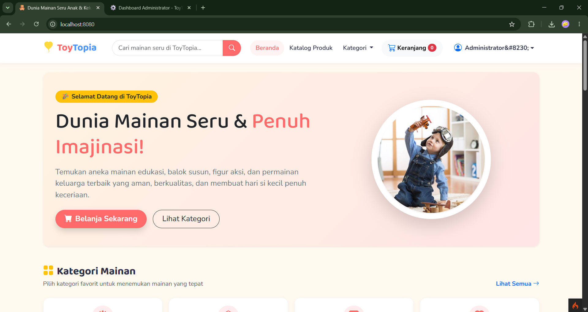
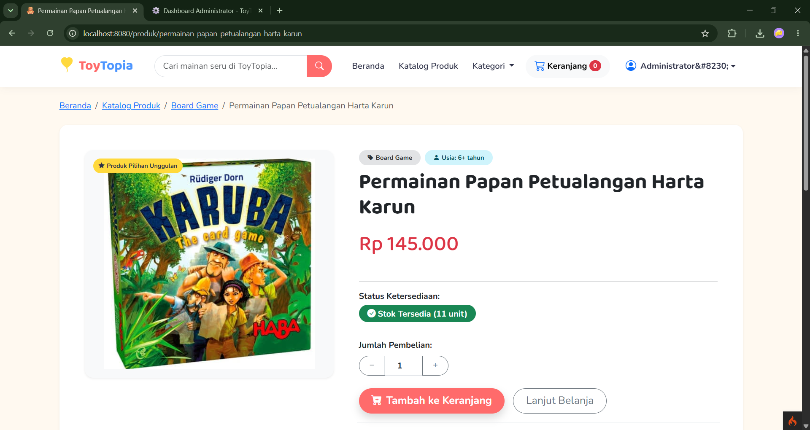
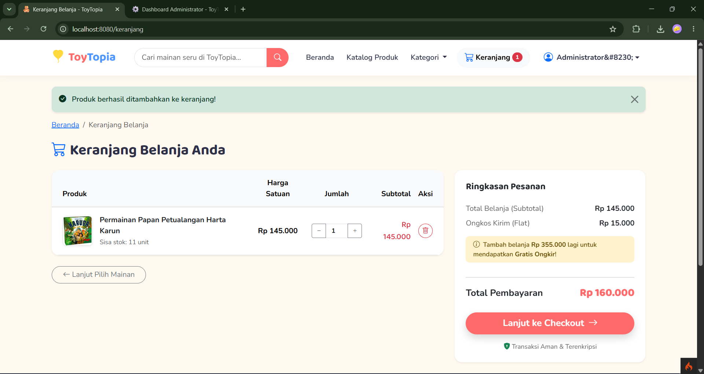
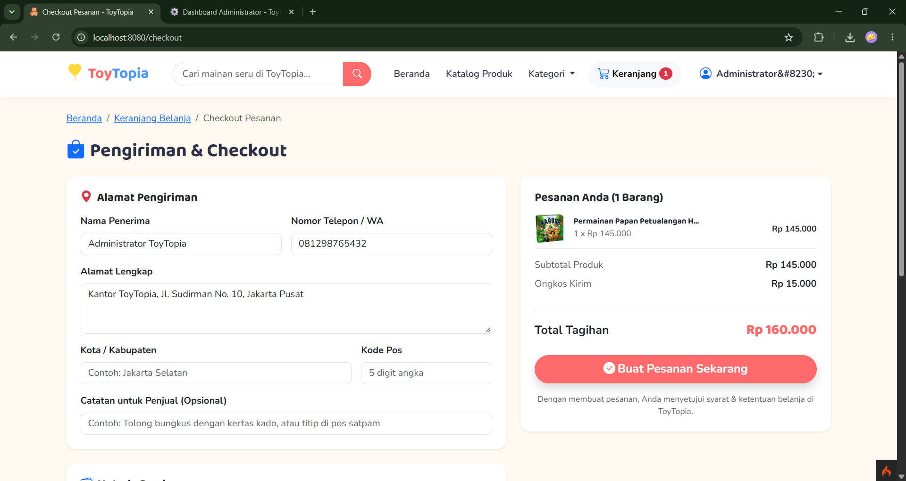
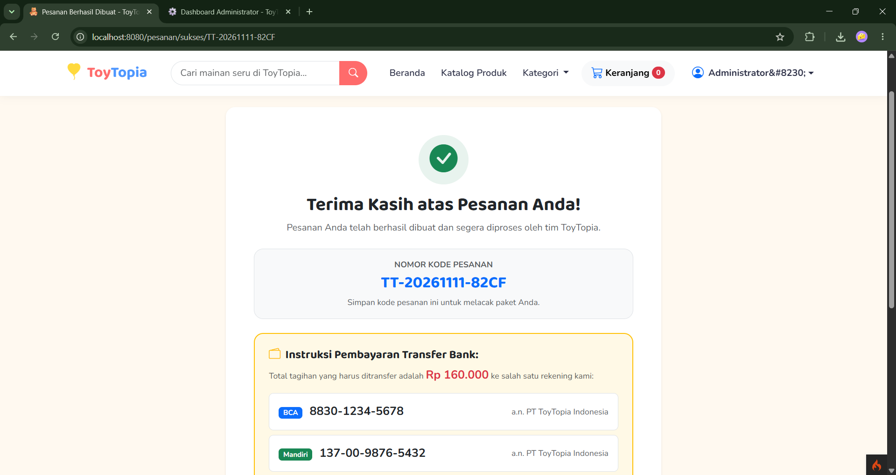
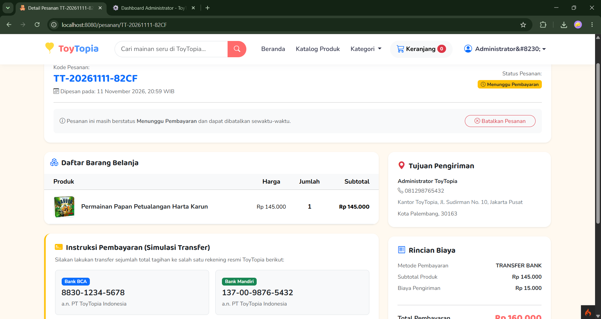
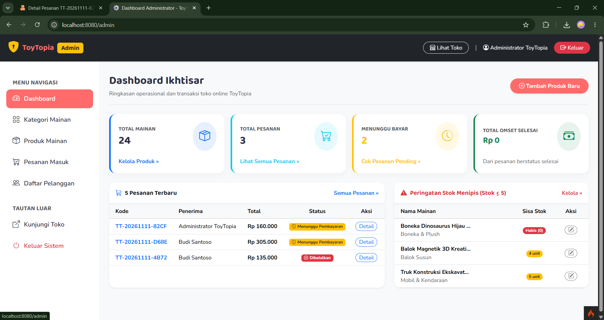
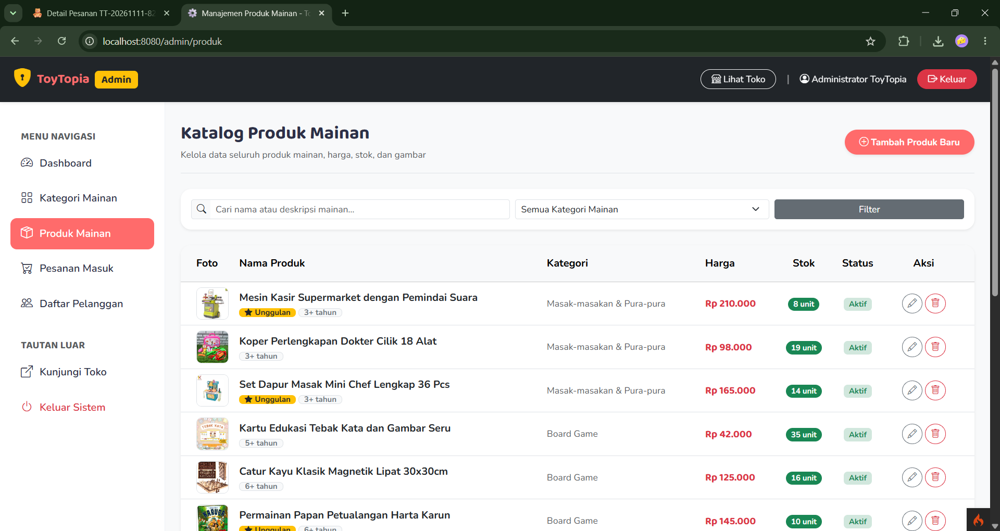
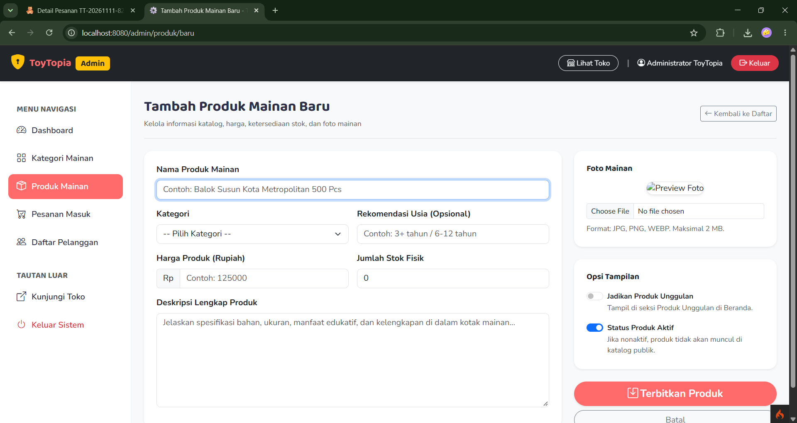
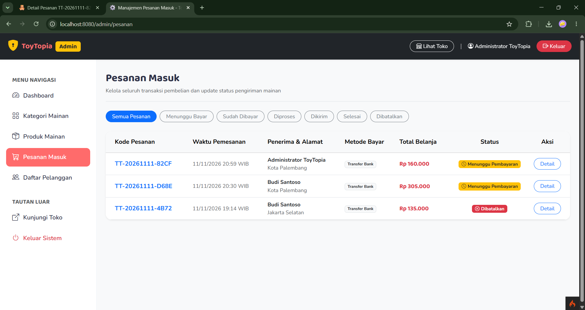

# LAPORAN TUGAS PERTEMUAN 9 PBKK (D)

---

### IDENTITAS MAHASISWA
* **Nama Lengkap :** Jorell Ramos Sinaga
* **NRP:** 5025241202
* **Mata Kuliah :** Pemrograman Berbasis Kerangka Kerja
* **Kelas:** D

---

## 1. RINGKASAN PROYEK

**ToyTopia** adalah aplikasi web toko online (*e-commerce*) bertema mainan anak dan keluarga yang dikembangkan menggunakan framework **CodeIgniter 4** (arsitektur MVC), basis data **MySQL/MariaDB**, dan antarmuka responsif **Bootstrap 5.3**. 

Aplikasi ini dirancang untuk memberikan pengalaman berbelanja yang ceria, interaktif, aman, dan mudah digunakan. Sistem mencakup dua hak akses utama:
1. **Sisi Pengunjung & Pelanggan (*Customer*):** Eksplorasi beranda dinamis, pencarian mainan, filter kategori dan harga, penambahan barang ke keranjang belanja (disimpan di database), proses checkout transaksional, pemantauan riwayat pesanan, serta pembatalan pesanan mandiri.
2. **Sisi Pengelola (*Administrator*):** Panel kendali `/admin` yang dilengkapi metrik ringkasan omset penjualan, pemantauan stok kritis (&le; 5 unit), CRUD kategori, CRUD produk lengkap dengan upload foto, pembaruan status pesanan, serta pemantauan data pelanggan terdaftar.

---

## 2. TEKNOLOGI & SPESIFIKASI SISTEM

| Komponen | Spesifikasi / Teknologi |
|---|---|
| **Bahasa Pemrograman** | PHP 8.1 / 8.2 |
| **Framework Backend** | CodeIgniter 4 (Clean ZIP Installation, tanpa Composer/npm eksternal) |
| **Arsitektur Sistem** | Model-View-Controller (MVC) |
| **Basis Data** | MySQL / MariaDB (via XAMPP) |
| **Frontend Framework** | Bootstrap 5.3 (via CDN), Bootstrap Icons (via CDN) |
| **Tipografi** | Google Fonts (*Baloo 2* untuk judul ceria, *Nunito* untuk keterbacaan teks) |
| **Manajemen State** | CodeIgniter Session & Database Cart Persistence |
| **Keamanan** | CSRF Token Protection, XSS Escaping (`esc()`), BCRYPT Password Hashing, HTTP Route Filters |

---

## 3. FITUR-FITUR YANG DIKERJAKAN

### A. Fitur Sisi Pelanggan & Publik
1. **Beranda Interaktif (`/`):** Hero banner dinamis, navigasi kategori cepat dengan ikon visual, katalog produk unggulan (*featured*), produk terbaru, dan kartu keunggulan belanja (SNI, packing aman, gratis ongkir).
2. **Katalog & Pencarian Cerdas (`/produk`):**
   * Pencarian teks bebas pada nama dan deskripsi produk.
   * Filter kategori instan (radio button).
   * Filter rentang harga minimum dan maksimum.
   * Pengurutan (*Terbaru*, *Harga Termurah*, *Harga Termahal*, *Nama A-Z*).
   * Paginasi otomatis (12 produk per halaman).
3. **Detail Produk (`/produk/{slug}`):**
   * Galeri foto produk dengan fallback otomatis (*placeholder*).
   * Informasi usia rekomendasi anak (misal: "3+ tahun").
   * Indikator ketersediaan stok (*Stok Habis*, *Tersisa X unit*, atau *Tersedia*).
   * Kontrol kuantitas (+/-) dengan pembatasan stok maksimum.
   * Seksi rekomendasi 4 produk terkait dari kategori yang sama.
4. **Autentikasi Pengguna (`/masuk` & `/daftar`):**
   * Validasi formulir pendaftaran akun (nama, email unik, minimal sandi 8 karakter, konfirmasi kecocokan).
   * Proteksi regenerasi sesi untuk mencegah serangan *session fixation*.
   * Pengalihan otomatis (*redirect*) kembali ke halaman yang sebelumnya dituju setelah login berhasil.
5. **Keranjang Belanja Persisten (`/keranjang`):**
   * Data keranjang disimpan di basis data (`cart_items`) sehingga tidak hilang saat pengguna berpindah perangkat atau login ulang.
   * Perhitungan otomatis subtotal, gratis ongkir untuk belanja &ge; Rp 500.000 (ongkir reguler flat Rp 15.000).
6. **Checkout Transaksional (`/checkout`):**
   * Otomatis memuat data penerima dari profil default.
   * Pilihan metode bayar: *Transfer Bank Manual* (simulasi rekening BCA/Mandiri) atau *Cash on Delivery (COD)*.
   * Implementasi **Database Transaction (ACID)**: Verifikasi stok langsung, pengurangan stok produk, pengosongan keranjang, dan penerbitan kode unik `TT-YYYYMMDD-XXXX`.
7. **Riwayat & Pembatalan Pesanan (`/pesanan`):**
   * Pelanggan dapat membatalkan pesanan yang masih berstatus `pending`.
   * **Stok otomatis dikembalikan** ke katalog saat pesanan dibatalkan.
8. **Profil Pengguna (`/profil`):**
   * Mengubah nama lengkap, nomor WhatsApp, alamat pengiriman default, dan penggantian kata sandi.

### B. Fitur Sisi Administrator (`/admin`)
1. **Dashboard Monitoring (`/admin`):**
   * Metrik statistik utama: Total Mainan, Total Pesanan, Pesanan Menunggu Pembayaran, dan Total Omset Penjualan Selesai.
   * Notifikasi *Early Warning* stok kritis (&le; 5 unit) untuk pengingat *restock*.
   * Tabel 5 transaksi pesanan paling baru.
2. **CRUD Kategori Mainan (`/admin/kategori`):**
   * Tambah, ubah, dan hapus kategori mainan.
   * Otomatis membuat *slug URL* ramah SEO.
   * **Proteksi Integritas Data:** Kategori yang masih memuat produk dilarang dihapus oleh sistem.
3. **CRUD Produk Mainan (`/admin/produk`):**
   * Tambah dan edit produk mainan.
   * Upload foto mainan (validasi tipe JPG/PNG/WEBP, kapasitas maksimal 2 MB, nama acak unik).
   * Fitur saklar (*switch*) penandaan "Produk Unggulan" dan "Status Aktif/Nonaktif".
4. **Manajemen Pesanan Masuk (`/admin/pesanan`):**
   * Filter pesanan berdasarkan status: *Menunggu Bayar*, *Sudah Dibayar*, *Diproses*, *Dikirim*, *Selesai*, *Dibatalkan*.
   * Rincian produk yang dipesan dengan **snapshot harga beli asli** (data riwayat belanja tidak akan berubah meskipun harga master produk diubah di kemudian hari).
   * Perubahan status ke `cancelled` otomatis mengembalikan stok fisik mainan.
5. **Daftar Pelanggan (`/admin/pelanggan`):**
   * Menampilkan daftar pelanggan terdaftar, akumulasi frekuensi belanja, dan total kontribusi omset.

---

## 4. STRUKTUR DATABASE (SKEMA TABEL)

Basis data bernama `toko_mainan` dibangun menggunakan **CodeIgniter Migration**:

```
+--------------------+       +--------------------+
|     categories     |       |       users        |
+--------------------+       +--------------------+
| id (PK)            |       | id (PK)            |
| name               |       | name               |
| slug (UNIQUE)      |       | email (UNIQUE)     |
| description        |       | password (HASH)    |
| image              |       | phone              |
| created_at         |       | address            |
| updated_at         |       | role (admin/cust)  |
+---------+----------+       +---+------------+---+
          | 1                    | 1          | 1
          |                      |            |
          | M                    | M          | M
+---------v----------+       +---v--------+ +-v------------------+
|      products      |       | cart_items | |       orders       |
+--------------------+       +------------+ +--------------------+
| id (PK)            |       | id (PK)    | | id (PK)            |
| category_id (FK)   |       | user_id(FK)| | order_code (UNIQUE)|
| name               |       | product(FK)| | user_id (FK)       |
| slug (UNIQUE)      |       | quantity   | | recipient_name     |
| description        |       +------------+ | phone / address    |
| price              |                      | payment_method     |
| stock              |                      | subtotal / total   |
| age_range          |                      | status             |
| image              |                      +---------+----------+
| is_featured / active                      | 1
+---------+----------+                                | M
          | 1                               +---------v----------+
          +-------------------------------->|    order_items     |
                                            +--------------------+
                                            | id (PK)            |
                                            | order_id (FK)      |
                                            | product_id (FK)    |
                                            | product_name (SNAP)|
                                            | price (SNAPSHOT)   |
                                            | quantity / subtotal|
                                            +--------------------+
```

---

## 5. PENJELASAN POTONGAN KODE PENTING (*KEY CODE SNIPPETS*)

Berikut adalah beberapa implementasi kode utama yang menjadi tulang punggung keamanan dan logika bisnis aplikasi:

### 1. Keamanan Akses dengan Filter Rute (`AuthFilter.php` & `AdminFilter.php`)
Memastikan pelanggan harus login sebelum bertransaksi, dan pelanggan biasa dilarang mengakses modul administrator.

```php
// File: app/Filters/AdminFilter.php
namespace App\Filters;

use CodeIgniter\Filters\FilterInterface;
use CodeIgniter\HTTP\RequestInterface;
use CodeIgniter\HTTP\ResponseInterface;

class AdminFilter implements FilterInterface
{
    public function before(RequestInterface $request, $arguments = null)
    {
        $session = session();
        // Cek apakah pengguna sudah login DAN memiliki role 'admin'
        if (!$session->get('is_logged_in') || $session->get('user_role') !== 'admin') {
            return redirect()->to(base_url('/'))->with('error', 'Akses ditolak! Halaman ini hanya dapat diakses oleh administrator.');
        }
    }

    public function after(RequestInterface $request, ResponseInterface $response, $arguments = null) {}
}
```
* **Penjelasan:** Filter ini dicegat sebelum controller dijalankan (`before`). Jika pengguna mencoba membuka `/admin` tanpa hak akses, sistem langsung melempar kembali ke beranda dengan pesan peringatan.

---

### 2. Transaksi Checkout Atomik & Snapshot Data (`Checkout.php`)
Menjaga konsistensi data stok dan riwayat harga menggunakan mekanisme **Database Transaction**:

```php
// File: app/Controllers/Checkout.php
$db = Database::connect();
$db->transBegin(); // Mulai transaksi database

try {
    foreach ($cartItems as $item) {
        $product = $this->productModel->find($item['product_id']);

        // 1. Validasi ketersediaan stok aktual
        if ($product['stock'] < $item['quantity']) {
            throw new \Exception('Stok mainan "' . $product['name'] . '" tidak mencukupi.');
        }

        // 2. Simpan snapshot harga & nama produk
        $orderItems[] = [
            'product_id'   => $product['id'],
            'product_name' => $product['name'], // Nama saat dibeli
            'price'        => $product['price'], // Harga saat dibeli
            'quantity'     => $item['quantity'],
            'subtotal'     => $product['price'] * $item['quantity'],
        ];

        // 3. Kurangi stok produk secara langsung
        $this->productModel->update($product['id'], [
            'stock' => $product['stock'] - $item['quantity']
        ]);
    }

    // 4. Buat pesanan induk & masukkan seluruh item belanja
    $orderId = $this->orderModel->insert($orderData);
    $this->orderItemModel->insertBatch($orderItems);

    // 5. Kosongkan keranjang belanja pengguna
    $this->cartModel->where('user_id', $userId)->delete();

    $db->transCommit(); // Simpan permanen jika semua tahap berhasil
    return redirect()->to(base_url('pesanan/sukses/' . $orderCode));
} catch (\Exception $e) {
    $db->transRollback(); // Batalkan seluruh perubahan jika ada galat
    return redirect()->back()->withInput()->with('error', $e->getMessage());
}
```
* **Penjelasan:** Konsep ACID memastikan bahwa pengurangan stok, penyimpanan faktur, dan penghapusan keranjang dieksekusi secara utuh. Jika terjadi kegagalan sistem di tengah jalan, seluruh proses dibatalkan (`rollback`) sehingga saldo stok tidak berkurang secara keliru.

---

### 3. Pengembalian Stok Otomatis Saat Pesanan Dibatalkan (`Orders.php`)
Ketika pesanan berstatus *pending* dibatalkan oleh pembeli atau admin, sistem secara otomatis mengembalikan kuantitas mainan ke stok aktif:

```php
// File: app/Controllers/Orders.php
$db->transBegin();
try {
    // Ubah status pesanan menjadi dibatalkan
    $this->orderModel->update($order['id'], ['status' => 'cancelled']);

    // Ambil daftar barang pesanan dan kembalikan stoknya
    $items = $this->orderItemModel->where('order_id', $order['id'])->findAll();
    foreach ($items as $item) {
        if (!empty($item['product_id'])) {
            $product = $this->productModel->find($item['product_id']);
            if ($product) {
                $this->productModel->update($item['product_id'], [
                    'stock' => $product['stock'] + $item['quantity'],
                ]);
            }
        }
    }
    $db->transCommit();
} catch (\Exception $e) {
    $db->transRollback();
}
```
* **Penjelasan:** Logika ini menjamin akurasi jumlah inventaris toko. Stok yang sebelumnya terpotong saat checkout akan dikembalikan secara tepat sesuai kuantitas yang dibatalkan.

---

### 4. Custom Helper Toko Mainan (`toko_helper.php`)
Fungsi bantuan global yang memudahkan pemformatan data berulang pada antarmuka pengguna:

```php
// File: app/Helpers/toko_helper.php

// Format Rupiah Indonesia
function format_rupiah($nominal): string {
    return 'Rp ' . number_format((float) $nominal, 0, ',', '.');
}

// Menghitung total item keranjang pengguna aktif
function cart_count(): int {
    $userId = session()->get('user_id');
    if (!$userId) return 0;

    $db = \Config\Database::connect();
    return (int) $db->table('cart_items')
        ->where('user_id', $userId)
        ->selectSum('quantity')
        ->get()->getRow()->quantity ?? 0;
}

// Badge status Bootstrap dinamis
function status_badge(string $status): string {
    $badges = [
        'pending'    => '<span class="badge bg-warning text-dark"><i class="bi bi-clock me-1"></i>Menunggu Bayar</span>',
        'paid'       => '<span class="badge bg-info text-dark"><i class="bi bi-wallet2 me-1"></i>Sudah Dibayar</span>',
        'processing' => '<span class="badge bg-primary"><i class="bi bi-box-seam me-1"></i>Diproses</span>',
        'shipped'    => '<span class="badge bg-secondary"><i class="bi bi-truck me-1"></i>Dikirim</span>',
        'completed'  => '<span class="badge bg-success"><i class="bi bi-check-circle me-1"></i>Selesai</span>',
        'cancelled'  => '<span class="badge bg-danger"><i class="bi bi-x-circle me-1"></i>Dibatalkan</span>',
    ];
    return $badges[$status] ?? '<span class="badge bg-light text-dark">' . esc($status) . '</span>';
}
```
* **Penjelasan:** Helper ini otomatis dimuat melalui `Autoload.php` sehingga dapat langsung dipanggil di seluruh Controller maupun View tanpa perlu inisialisasi ulang.

---

## 6. PANDUAN MENJALANKAN APLIKASI

### Langkah 1: Persiapan Server
1. Buka aplikasi **XAMPP Control Panel**.
2. Aktifkan modul **Apache** dan **MySQL**.

### Langkah 2: Konfigurasi Basis Data
1. Buka browser dan kunjungi `http://localhost/phpmyadmin/`.
2. Buat database baru bernama: `toko_mainan`.

### Langkah 3: Eksekusi Migrasi & Seeder Data Awal
Buka terminal / Command Prompt pada direktori proyek (`C:\xampp\htdocs\ToyTopia`), lalu jalankan perintah:

```bash
# Membuat struktur tabel lengkap
php spark migrate

# Memasukkan data akun demo, 8 kategori, dan 24 produk mainan
php spark db:seed DatabaseSeeder
```

### Langkah 4: Menjalankan Server Aplikasi
Jalankan perintah berikut:
```bash
php spark serve
```
Akses aplikasi melalui browser di alamat:
👉 **`http://localhost:8080/`**

### Kredensial Akun Uji Coba:
* **Akun Administrator :** `admin@toytopia.test` | Kata Sandi: `admin123`
* **Akun Pelanggan     :** `budi@toytopia.test`  | Kata Sandi: `user12345`

---

## 7. HASIL TAMPILAN APLIKASI (DOKUMENTASI SCREENSHOT)

### 1. Halaman Beranda Publik
Menampilkan hero banner bertema anak, daftar kategori mainan, produk pilihan unggulan, produk terbaru, dan footer informatif.


---

### 2. Halaman Katalog & Filter Produk
Menampilkan daftar seluruh mainan dengan sidebar filter kategori, slider rentang harga, kolom pencarian, dan dropdown pengurutan.


---

### 3. Halaman Detail Produk
Menampilkan foto mainan resolusi tinggi, rekomendasi usia, badge ketersediaan stok, form kuantitas (+/-), dan rekomendasi 4 produk terkait.


---

### 4. Halaman Keranjang Belanja
Menampilkan tabel daftar belanjaan, pengubah kuantitas item, perhitungan subtotal, indikator bebas biaya kirim (*Free Shipping*), dan tombol lanjut checkout.


---

### 5. Halaman Formulir Checkout
Menampilkan isian alamat pengiriman lengkap, pemilihan metode pembayaran (Transfer Bank / COD), dan tombol konfirmasi transaksi.


---

### 6. Halaman Status Pesanan Sukses
Menampilkan ucapan terima kasih, nomor kode pesanan unik, rincian biaya, dan petunjuk transfer rekening bank resmi.


---

### 7. Halaman Riwayat & Detail Pesanan Saya
Menampilkan status pesanan pelanggan dan tombol pembatalan mandiri untuk pesanan yang masih berstatus *Menunggu Pembayaran*.


---

### 8. Halaman Dashboard Administrator
Menampilkan ringkasan metrik omset penjualan, total pesanan, grafik stok menipis (&le; 5 unit), dan daftar transaksi paling baru.


---

### 9. Halaman Manajemen Produk Admin
Menampilkan tabel inventaris master produk dengan fitur pencarian admin, status keaktifan, dan tombol edit/hapus.


---

### 10. Halaman Formulir Tambah/Ubah Produk
Menampilkan isian nama mainan, pemilihan kategori, input harga, kuantitas stok, upload gambar produk interaktif, dan switch produk unggulan.


---

### 11. Halaman Manajemen Pesanan Masuk Admin
Menampilkan daftar pesanan masuk dengan navigasi tab per status pesanan, serta modal/form pengubahan status pesanan pengiriman.


